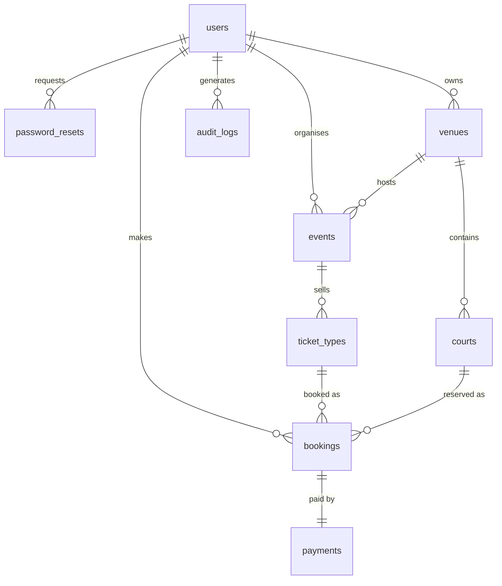

# BOOM+ — Sections 1 & 2 (Hafiq: Database & Security Lead)

## Section 1: System Overview

### Objectives
- Provide one shared RESTful API (PHP + MySQL on XAMPP) for sport event ticketing and venue / court booking.
- Support exactly three sports: **Pickleball, Futsal, Badminton**.
- Secure every protected endpoint with JWT authentication and role-based access control (RBAC).
- Give each of the three roles (admin, organiser, customer) a purpose-built frontend that runs locally on XAMPP.

### Target users
| Role | Core functions |
|---|---|
| Administrator | Manage users and roles, manage every venue and event, oversee bookings, audit and request logs |
| Organiser / Staff | Manage own venues, courts, schedules, events and ticket capacity; view and manage bookings; check guests in |
| Customer | Browse events, check live availability, book / modify / cancel tickets and courts, view own tickets and history |

### Architecture
```
Browser (HTML + CSS)
   │
   ▼
PHP portals  Hafiq/ Akma/ Ariff/ Putera_Aidil/      shared/ (layouts, themes, API client)
   │  session stores the JWT; calls the API with cURL-style HTTP + Bearer token
   ▼
REST API  /boom/api   (Apache mod_rewrite → api/index.php → routes/<resource>.php)
   │  middleware: security headers → rate limit → request log → error handler → validation → JWT/RBAC
   ▼
MySQL / MariaDB  boom_plus  (PDO, prepared statements)
   │
   └── external service: api.qrserver.com (QR code for every booking)
```

### Security design
bcrypt password hashes; HS256 JWT (1 hour, algorithm pinned, constant-time signature check); the user is re-read from the database on every request so disabled accounts and role changes apply immediately; public registration always creates a `customer`; generic login errors; reset tokens stored as SHA-256, single use, 1 hour expiry; prepared statements everywhere; CSRF tokens and output escaping in the portals; audit trail in `audit_logs`.

## Section 2: Database Design

### ERD

`request_logs` and `rate_limits` are infrastructure tables written by the logging and rate-limit middleware.
`role` (users) and `sport` (courts, events) are ENUM columns, so there are no 3-row lookup tables and every table holds 5 or more sample rows.

### Data dictionary
**users** — `user_id` PK · `role` ENUM(admin, organiser, customer) · `full_name` · `email` UNIQUE · `password_hash` · `phone` · `is_active` · `created_at` · `updated_at`

**password_resets** — `reset_id` PK · `user_id` FK→users (cascade) · `token_hash` UNIQUE (SHA-256) · `expires_at` · `used_at` · `created_at`

**venues** — `venue_id` PK · `owner_id` FK→users · `venue_name` · `address` · `city` · `capacity` (>0) · `contact_phone` · `is_active` · `created_at`

**courts** — `court_id` PK · `venue_id` FK→venues (cascade) · `sport` ENUM(Pickleball, Futsal, Badminton) · `court_name` (unique per venue) · `hourly_rate` (≥0) · `is_active`

**events** — `event_id` PK · `organiser_id` FK→users · `venue_id` FK→venues · `sport` ENUM · `title` · `description` · `start_time` · `end_time` (> start) · `status` ENUM(draft, published, cancelled, completed) · timestamps

**ticket_types** — `ticket_type_id` PK · `event_id` FK→events (cascade) · `type_name` (unique per event) · `price` (≥0) · `capacity` · `sold` (CHECK sold ≤ capacity)

**bookings** — `booking_id` PK · `booking_ref` UNIQUE · `user_id` FK→users · `booking_type` ENUM(event_ticket, court) · `ticket_type_id` FK (nullable) · `court_id` FK (nullable) · `quantity` · `slot_start` / `slot_end` · `total_amount` · `status` ENUM(pending, confirmed, cancelled, completed) · `qr_code` (cached QR data URI) · timestamps

**payments** — `payment_id` PK · `booking_id` FK→bookings UNIQUE (cascade) · `amount` · `method` ENUM(card, fpx, ewallet, cash) · `status` ENUM(pending, paid, failed, refunded) · `paid_at`

**audit_logs** — `log_id` PK · `user_id` FK→users (set null) · `action` · `detail` · `ip_address` · `created_at`

**request_logs** — `request_id` PK · `user_id` · `method` · `path` · `status_code` · `duration_ms` · `ip_address` · `created_at`

**rate_limits** — composite PK (`bucket`, `window_start`) · `hits`

### SQL scripts
`database/boom_plus.sql` contains the executable DDL (tables, keys, indexes, CHECK constraints) followed by the DML sample data (5 to 8 rows per table). Event and booking dates are generated relative to `CURDATE()` so demo data never goes stale. Import it with phpMyAdmin or `mysql -u root < database/boom_plus.sql`.
